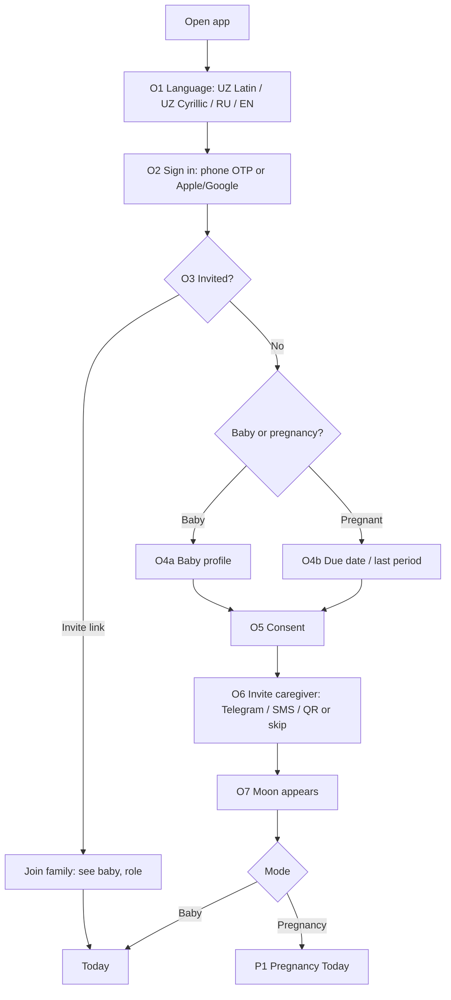
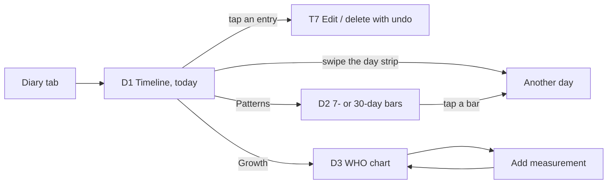
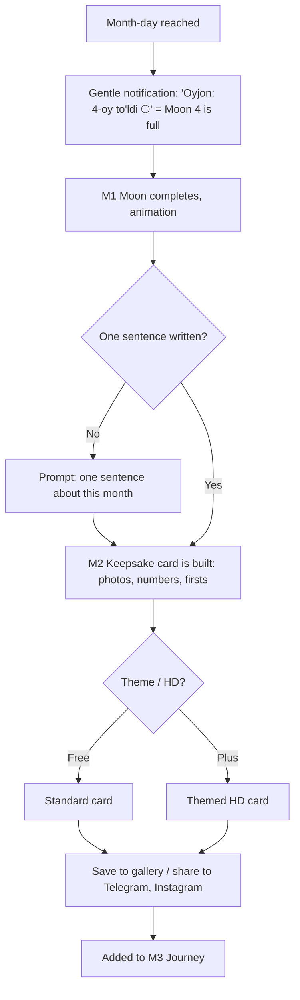
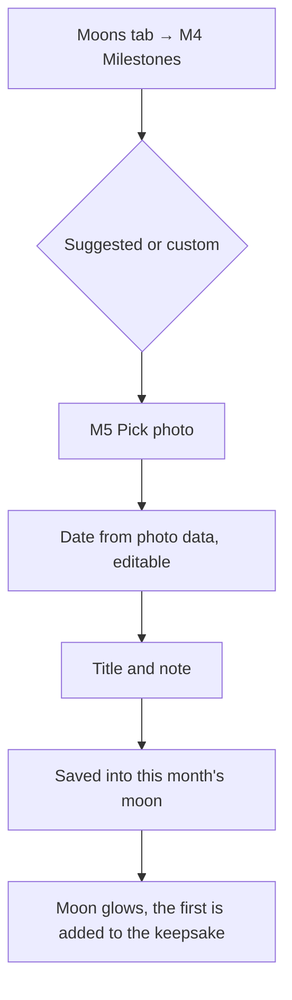
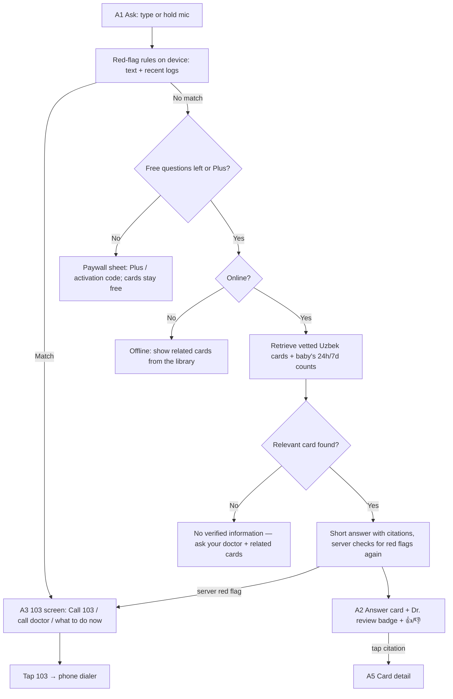
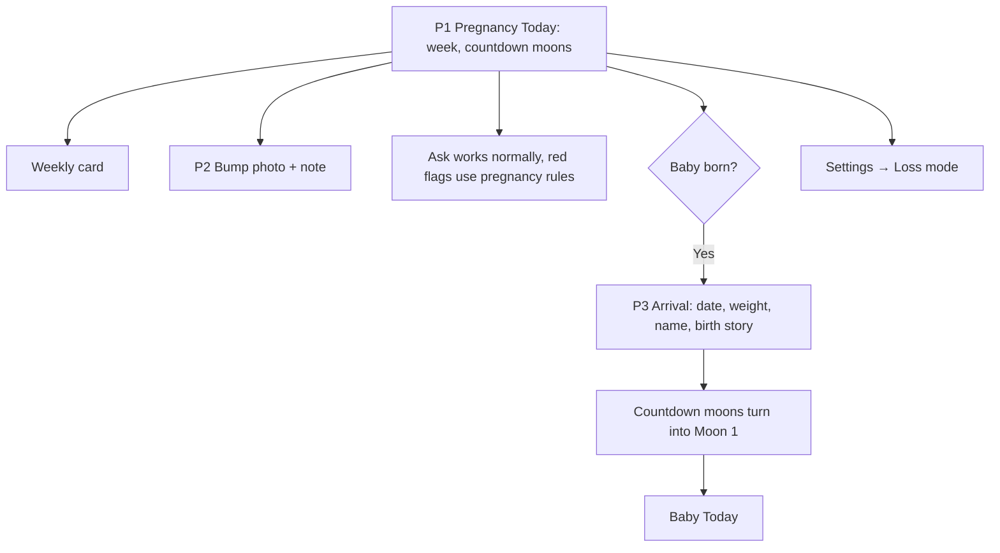
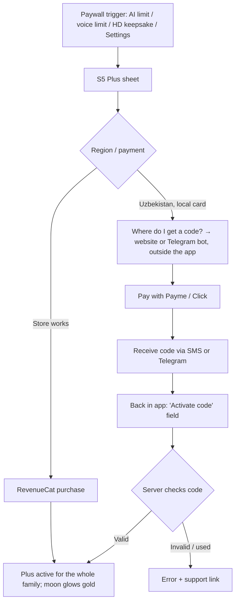
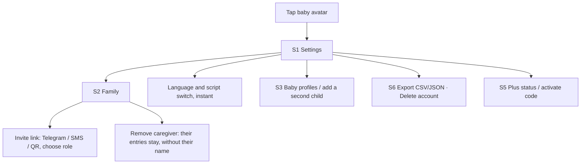

# Screens and flows (v1)

Scope comes from [`product.md`](product.md); safety behaviour from [`safety.md`](safety.md). The app is native Expo for iOS and Android. Languages: Uzbek Latin (default), Uzbek Cyrillic, Russian, English.

Where a screen says **103**, that's the Uzbekistan number; the app always uses `region.emergencyNumber`.

**Design principles**
- **One thumb at 3am.** Log tiles sit low, with a 56pt+ hit area.
- **Calm.** No streaks, no red badges for missed logs, no scores. Percentiles are shown as reference points.
- **Night mode.** It turns on automatically from 21:00 to 06:00: deep indigo with warm saffron and cream text, low contrast, no white flashes.
- **Safety beats paywalls.** The 103 screen, loss mode, export and deletion are never paywalled or rate-limited.
- **Taste.**
  - From Airbnb: big tactile cards, a sticky bottom action, sheets that expand to full screen, shared-element transitions from a card to its detail screen.
  - From Linear: a fast command-style log sheet, crisp lists, keyboard-like speed, no unnecessary steps or confirmations, quiet "Saved ✓" toasts.

---

**Companion:** the Oyim moon character (Grok Bot-style avatar, made softer and warmer) is defined in [`companion.md`](companion.md). She is hidden on A3 (103) and S4 (loss mode).

---

## 1. Navigation

**4 tabs and a centre action:**

| Tab | Icon | Contents |
|---|---|---|
| **Bugun** (Today) | sun | Now screen: time since last feed, sleep and diaper; quick tiles; "This week" cards |
| **Kundalik** (Diary) | list | Daily timeline, patterns, growth |
| **＋ Log** (centre) | moon button | Log sheet. Long-press for voice. |
| **Oy** (Moons) | moon | Moon of the current month, all moons in the Journey view, milestones and photos |
| **So'rang** (Ask) | spark | AI assistant and the card library |

- **Settings and Family** open from the baby avatar at the top left of Today, as a modal stack.
- **Pregnancy mode** uses the same tabs. Today shows the week, Diary becomes the bump journal, Moons shows the countdown, and Ask works as normal.
- **Global layers above every screen:**
  - The red-flag 103 screen.
  - An offline banner.
  - The active-timer pill: a floating pill showing a running timer, similar to an iOS Live Activity.

---

## 2. Screen inventory

★★★ = critical, design these first. ★★ = important. ★ = supporting.

**State columns:** E = empty, L = loading, Er = error, Off = offline, P = paywall.

### Onboarding
| # | Screen | Purpose and key content | States |
|---|---|---|---|
| O1 ★★ | **Welcome / language** | Oyjon logo with the moon motion. Oyim says hello (companion §5). 4 language pills: O'zbek (Lotin), Ўзбек (Кирил), Русский, English. | — |
| O2 | **Sign in** | Phone number OTP (country code from her country, +998 for Uzbekistan), Apple or Google sign-in | L: sending code · Er: wrong code, resend in 60s · Off: "Internet kerak" (internet needed) |
| O3 ★★ | **Baby or pregnancy** | Two big cards: "Chaqalog'im bor" (I have a baby) and "Homiladorman" (I'm pregnant). A link: "I was invited" | — |
| O4a | **Baby profile** | Name, birth date, sex (optional), photo, birth weight and length (optional) | Er: date in the future |
| O4b | **Pregnancy profile** | Due date or last period date, a gentle note on what the dates are used for | — |
| O5 | **Consent and privacy** | 3 short points, each with its own toggle: health data consent (required), anonymous question log for doctor review (optional), notifications | Can't continue without the required consent |
| O6 | **Invite caregiver** | Shareable invite link (Telegram, SMS, copy), a QR code, roles: parent / helper. "Keyinroq" (later) to skip. | — |
| O7 | **First moment** | The moon appears, with Moon 1 or the pregnancy week, then lands on Today | — |

### Today and logging
| # | Screen | Purpose and key content | States |
|---|---|---|---|
| T1 ★★★ | **Today (Bugun)** | Header: baby avatar, age ("3 oy 12 kun", 3 months 12 days), a small moon showing the month's progress. **"Time since" cards** for feed, sleep and diaper, each with a big relative time, the last amount or side, and who logged it. Running timer card. Quick tiles. "Bu hafta" (this week) carousel with 3 cards. An optional nap-range chip. | E: "Birinchi yozuvni qo'shing" (add the first entry), with a hint pointing to the ＋ button · L: skeleton cards · Off: banner "Oflayn: yozuvlar saqlanadi" (offline: entries are saved); entries waiting to sync get a dot · Er: sync failure banner with retry |
| T2 ★★★ | **Log sheet** | Bottom sheet with 4 large tiles (Ovqat/feed, Uyqu/sleep, Taglik/diaper, Boshqa/other) and a mic button. Tapping a tile turns the sheet into its form (shared element). | — |
| T3 ★★★ | **Feed form** | Segments: Ko'krak (breast), Shisha (bottle), Qo'shimcha (solids). Breast: L and R timers (tap to start, tap the other side to switch). Bottle: ml stepper and wheel, formula or breast milk. Time defaults to now; drag sideways to adjust. Note field. | Validation for unrealistic amounts |
| T4 ★★ | **Sleep form** | Big start/stop button, or a manual start–end range with two drag handles | Overlap warning when it clashes with another sleep entry |
| T5 ★★ | **Diaper form** | 3 chips (Ho'l/wet, Iflos/dirty, Ikkalasi/both), optional colour picker. Saves in one tap. | — |
| T6 ★★ | **Voice log** | Hold the mic: live waveform, a transcript as she speaks, parsed into entry chips she confirms or swipes away | L: "Tinglayapman…" (listening) · Er: "Tushunmadim" (didn't understand) with a manual fallback · Off: voice disabled, use tiles · P: after 10 a month, "Plus bilan cheksiz" (unlimited with Plus) |
| T7 | **Entry detail / edit** | Fields, who logged it, edit and delete (with an undo toast instead of a confirm dialog) | — |

### Diary
| # | Screen | Purpose and key content | States |
|---|---|---|---|
| D1 ★★★ | **Timeline** | Horizontal day strip at the top (swipe between days). Totals for the day (feeds, ml, sleep, diapers). Entries newest first with caregiver avatars. Filter chips. | E: "Bu kun yozuv yo'q" (no entries this day) · L: skeleton · Off: local data plus a sync dot |
| D2 ★★ | **Patterns** | 7-day and 30-day bars for feeds per day, sleep in the night and day, and diapers. Tap a bar to jump to that day. No targets. | E: "3 kundan keyin naqshlar ko'rinadi" (patterns appear after 3 days) · P: 30-day view and more history are free; nothing locked |
| D3 ★★ | **Growth** | Tabs for weight, length and head. WHO percentile curves with the baby's points, a list of measurements, add a measurement. | E: only the birth point shown, with a prompt to add a measurement |

### Moons (Oy)
| # | Screen | Purpose and key content | States |
|---|---|---|---|
| M1 ★★★ | **Current moon** | A large moon that fills (lit fraction = days elapsed, plus a glow per log and photo). Below it: this month's photos, firsts, key numbers. A "Shu oy haqida bir jumla" field (one sentence about this month). | E: new month, a crescent with "Shu oyning birinchi suratini qo'shing" (add the first photo) |
| M2 ★★★ | **Full-moon keepsake** | Card: photo, "4-oy" (month 4), numbers ("212 marta ovqat · +620 g" = 212 feeds, +620 g), firsts, her sentence. Choose a theme, save to the gallery, share to Telegram or Instagram. | L: rendering the card · P: HD and themed versions locked; the standard card is free |
| M3 ★★ | **Journey** | Horizontal row of moons from the pregnancy countdown to Moon 12. Pinch out to see the whole year. Tap a moon to open that month. | Future moons show as faint outlines |
| M4 ★★ | **Milestones and photos** | List of firsts (first smile, rolling over…), with a suggested list and custom entries. Add a photo and date to each. Photo grid by month. | E: suggestions as soft placeholders. No "late" or "early" labels. |
| M5 | **Add milestone / photo** | Pick a photo, date (taken from the photo's data), title, note; choose which moon it belongs to | Er: no photo permission, with a link to Settings |

### Ask (So'rang)
| # | Screen | Purpose and key content | States |
|---|---|---|---|
| A1 ★★★ | **Ask home** | Input with a mic, suggested questions for the baby's age, recent answers, a small "3/3 bu hafta" (3 of 3 this week) counter on the free plan, the card library entry | Off: "Savol berish uchun internet kerak" (internet needed to ask); the card library still works offline |
| A2 ★★★ | **Answer card** | Question, a short answer of 3–5 sentences, the baby's own data inline ("Bugun 6 ta ho'l taglik ✓", 6 wet diapers today), numbered citation chips (tap to open the source card), "Shifokor ko'rib chiqqan: Dr. …" (reviewed by Dr. …), thumbs up/down, a fixed footer "Bu tashxis emas…" (this is not a diagnosis) | L: moon shimmer while answering · Er: retry · No source found: "Tasdiqlangan ma'lumot yo'q — shifokoringizdan so'rang" (no verified information, ask your doctor) · P: after 3 questions a week, a paywall sheet, but **if a red flag matches, the 103 screen always shows** |
| A3 ★★★ | **Red-flag 103 screen** | Full-screen calm red (not alarming neon): "Hozir tez yordam chaqiring" (call an ambulance now). Huge **103** call button, a secondary "Shifokoringizga qo'ng'iroq" (call your doctor), the symptom matched, what to do while waiting (3 fixed lines). No AI text. **No companion.** | Works offline (the rules run on the device) |
| A4 ★★ | **Card library** | Topics by age, search, saved cards | E: no saved cards yet |
| A5 ★★ | **Card detail** | Title, 120–200 words, sources, reviewing doctor and date, "Savol berish" (ask a follow-up) | — |

### Pregnancy mode
| # | Screen | Purpose | States |
|---|---|---|---|
| P1 ★★ | **Pregnancy Today** | Week number, days to go, countdown moons, this week's card, a bump-photo prompt, a mood or one-line note | — |
| P2 | **Bump journal** | Timeline of bump photos and notes, compare photos side by side | E: first-photo prompt |
| P3 ★★ | **Baby arrived** | Birth date, time, weight and name, plus the birth-story prompt (voice or text). Turns the countdown into Moon 1. | — |

### Settings and family
| # | Screen | Purpose and key content | States |
|---|---|---|---|
| S1 | **Settings** | Language and script, units, night mode, notifications, Plus status, privacy, export, delete account, loss mode (under "Homiladorlik"/pregnancy, worded gently), help, legal | — |
| S2 ★★ | **Family** | Caregivers with roles and colours, invite, remove (with an explanation that their entries stay), pending invites | E: "Hali hech kim yo'q" (no one here yet) with a big invite button |
| S3 | **Baby profile(s)** | Edit the profile, add a second child, switch between children | — |
| S4 ★★ | **Loss mode** | Gentle copy, choose to archive or delete, confirm. Afterwards: one support card and a plain app. **Companion hidden.** | — |
| S5 ★★ | **Oyjon Plus** | Benefits list, "safety and logging are always free", plans. **iOS/Android global:** store purchase. **UZ:** "Kodni faollashtirish" (activate code) and "Qayerdan olish?" (where do I get one?), which opens the website or Telegram bot | L: purchasing · Er: invalid or used code · Success: the moon glows gold |
| S6 | **Export / delete** | CSV/JSON export through the share sheet; delete everything with a confirmation of type-the-name strength | — |

---

## 3. Flows

### 3.1 Onboarding


### 3.2 Quick log (tiles and voice)
```mermaid
flowchart TD
  A[Tap moon ＋] --> B[T2 Log sheet]
  A -- long press --> V[T6 Voice: hold and speak]
  B --> C{Tile}
  C -- Feed --> F[T3 L/R timer or bottle ml]
  C -- Sleep --> S[T4 Start timer or range]
  C -- Diaper --> D[T5 One tap: wet/dirty/both]
  F --> Sv[Save → local SQLite]
  S --> Sv
  D --> Sv
  V --> P[Speech-to-text, Uzbek or Russian] --> Ch[Entry chips] --> Cf{Confirm?}
  Cf -- swipe a chip away --> Ch
  Cf -- Confirm --> Sv
  Sv --> Sy{Online?}
  Sy -- Yes --> Up[Sync, others notified] --> Ok[Saved ✓ toast and moon glows]
  Sy -- No --> Q[Queued, dot shown] --> Ok
  Sv -.red-flag rule match e.g. no wet diaper 12h.-> R[A3 103 screen]
```

### 3.3 Daily timeline and patterns


### 3.4 Monthly moon keepsake


### 3.5 Milestones and photos


### 3.6 AI assistant, including the red flag


### 3.7 Pregnancy mode


### 3.8 Loss mode
```mermaid
flowchart TD
  A[Settings → Pregnancy → 'Homiladorlik tugadi' (pregnancy ended)] --> B[Gentle explainer, no images]
  B --> C{What to do with entries}
  C -- Keep privately --> D[Archive: hidden from Today]
  C -- Delete --> E[Delete pregnancy data, confirm]
  D --> F[All pregnancy notifications and cards stop immediately]
  E --> F
  F --> G[One support card + option to contact a doctor or psychologist]
  G --> H[Quiet app; later: 'Start again' option]
```

### 3.9 Oyjon Plus upgrade

*Check Apple's and Google's rules before launch. The in-app "where do I get a code?" link may need to be removed for store compliance; if so, rely on Telegram and the website only.*

### 3.10 Settings and family


---

## 4. Motion and gesture moments (where to spend polish)

| Moment | What happens | Reference |
|---|---|---|
| **The moon ＋ button** | Tap: the moon rises and the sheet springs up from it. Long-press: the moon breathes and waveform rings ripple out (voice). | Linear's command menu (speed), iOS Dynamic Island morph |
| **Log tile → form** | The tile expands into the form (shared element); the other tiles fade back | Airbnb listing card → detail |
| **Save** | The sheet folds down into the moon, one sliver of light is added, a soft haptic tap, "Saved ✓" | Linear's quiet toast |
| **Breast timer** | Big L/R halves; tap the other side and the light slides across; the timer pill stays on top of every screen | Live Activity |
| **Time adjust** | Drag the time chip sideways in 1-minute steps, with a haptic per 5 minutes | iOS picker but faster |
| **Voice chips** | The transcript breaks into chips that spring into the form; swipe a chip away to remove it | Fondnotes chip idea, reused |
| **Day strip** | Swipe days with momentum; totals count up | Airbnb date picker |
| **Full moon** | On the month-day the moon fills, glows, photos orbit in and settle onto the card, and the card lifts with a parallax tilt (follows the gyroscope) | Airbnb Wishlists / Apple Wallet pass |
| **Journey pinch** | Pinch out from one moon to see all 12 in an arc; tap one to zoom back in | Apple Photos years/months zoom |
| **Answer card** | The answer unfolds from the moon; citation chips slide in last; the baby's numbers get a soft highlight | Linear's calm progressive reveal |
| **103 screen** | No playful motion: an instant, solid transition and a strong haptic. Seriousness is the point. | — |
| **Plus success** | The moon glows gold once, no confetti | — |
| **Night mode** | Indigo night cross-fade at 21:00; animations slow down by 30% | — |

Respect the system "Reduce Motion" setting: replace the motion with simple fades.

---

**Companion moments:** onboarding guide, a nod on save, the month's moon (she *is* the moon), empty-state peeks, listening and thinking states in Ask (then she shrinks so sources lead), a sleepy crescent at night. Rules and caps: [`companion.md`](companion.md) §6.

## 5. Suggested design order

1. **T1 Today** and **T2–T5 Log sheet and forms** (the core of daily use and the night-mode palette)
2. **D1 Timeline** (proves the visual system for lists)
3. **M1 Moon** and **M2 Full-moon keepsake** (the signature, and the main reason to share the app)
4. **A1–A3 Ask, Answer card, 103 screen** (the main difference from other apps; design 103 together with the doctors' wording)
5. **O1–O7 Onboarding** (once the main screens' look is settled)
6. **T6 Voice log**
7. **D2–D3 Patterns and growth**, **M3–M5 Journey and milestones**
8. **P1–P3 Pregnancy**, **S4 Loss mode**
9. **Companion (Oyim) Skia rig:** sketch her alongside steps 1–3 so her states match the moon system
10. **S5 Plus**, **S1–S3, S6 Settings, family and export**

**Design system first (½ day):** colour tokens (day and indigo night), type scale with Uzbek and Cyrillic glyph checks (long Uzbek words like "ovqatlantirish" (feeding) must not break layouts), moon icon set (8 phases), caregiver colours, spring presets (tight, soft, slow).
